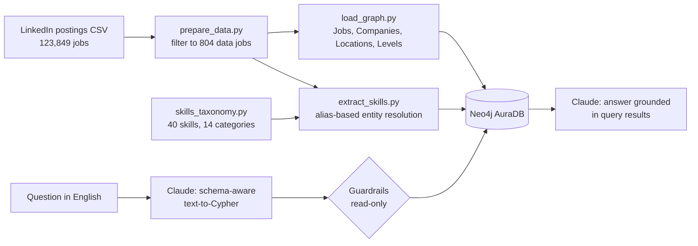

# Job Market Knowledge Graph


A knowledge graph of 804 real data engineering, BI and data architecture job postings, built with **Neo4j**,
**Python** and **Claude**. It resolves messy skill mentions into a clean taxonomy and answers plain-English
questions about the job market by generating Cypher (GraphRAG), with read-only guardrails.

```
$ python ask.py "Which companies post the most senior data engineer jobs?"

Capital One posts the most senior data engineer jobs (14), followed by Publicis Sapient (12) ...
```

## Architecture



## Graph model

```
(Job)-[:POSTED_BY]->(Company)
(Job)-[:LOCATED_IN]->(Location)
(Job)-[:HAS_LEVEL]->(ExperienceLevel)
(Job)-[:MENTIONS]->(Skill {name, aliases})-[:IN_CATEGORY]->(SkillCategory)
```

| | Count |
|---|---|
| Jobs | 804 |
| Companies | 530 |
| Locations | 242 |
| Skills / categories | 40 / 14 |
| Job–skill links | 5,123 |

## What it does

**Entity resolution with a skill taxonomy.** Job descriptions name the same skill many ways ("AWS",
"Amazon Web Services"; "PySpark", "Apache Spark"; "PowerBI", "Power BI"). `skills_taxonomy.py` maps every
alias to one canonical `Skill` node and groups skills into categories, so "Spark" is counted once, not three times.

**GraphRAG question answering.** `ask.py` sends Claude the graph schema (not the data), gets back one Cypher
query as structured JSON, runs it, and has Claude answer only from the returned rows. If a query fails, the
database error is sent back for one self-correcting retry.

**Read-only guardrails (defense in depth).**
1. The prompt allows only read clauses.
2. A pattern check blocks `CREATE`, `MERGE`, `DELETE`, `SET` and similar before anything reaches Neo4j.
3. Queries run in a Neo4j read transaction, so the database itself rejects writes.

**Tested and CI'd.** Unit tests cover alias resolution and tricky edge cases ("JavaScript" is not Java,
"scalable" is not Scala, "HTML" is not ML) and taxonomy integrity. GitHub Actions runs them on every push.

## Example questions

- Which companies post the most senior data engineer jobs?
- What are the top 10 skills mentioned in jobs located in Texas?
- Which BI tools are mentioned most?
- What is the average max salary for jobs that mention Snowflake versus Databricks?

## Run it

```bash
python -m venv .venv && .venv\Scripts\activate
pip install -r requirements.txt
cp .env.example .env        # then fill in your Neo4j and Anthropic values
python prepare_data.py      # needs data/raw/postings.csv (see Data below)
python load_graph.py
python extract_skills.py
python ask.py "Which skills are mentioned most in Mid-Senior level jobs?"
pytest -v
```

## Design decisions and limitations

- **`MENTIONS`, not `REQUIRES`:** text matching can't tell required skills from nice-to-have ones, so the
  relationship says only what is known.
- **Rule-based extraction first:** regex aliases are fast, free, deterministic and testable. An LLM
  extraction pass could add context (required vs. preferred, years of experience) as a next step.
- **Staffing agencies:** many top "companies" are recruiters posting for clients; tagging them is a planned
  enrichment.
- **Locations** are stored as posted ("Atlanta, GA", "United States"); normalizing them into
  `City`/`State` nodes is a planned improvement.

## Data

[LinkedIn Job Postings (2023–2024)](https://www.kaggle.com/datasets/arshkon/linkedin-job-postings) on Kaggle.
The raw data is not included in this repository; download it from Kaggle and see the dataset page for its license.

## Tech

Neo4j AuraDB · Cypher · Python · pandas · Claude (Anthropic API) · pytest · GitHub Actions

---
Built by [Sarathchandra Mulukutla](https://linkedin.com/in/smulukutla)